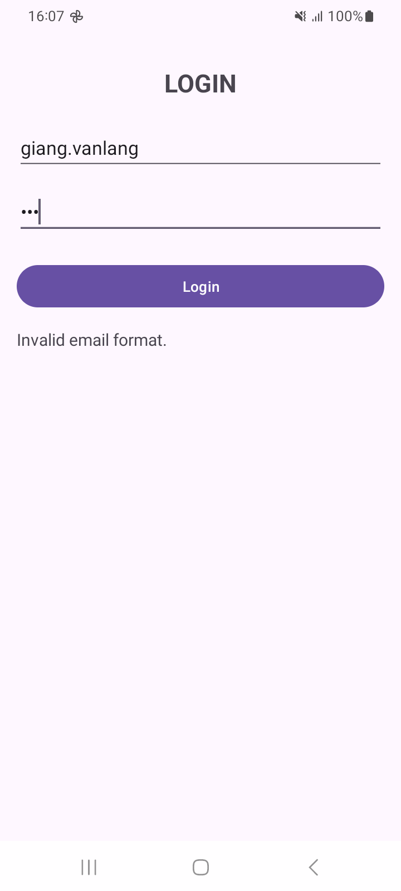
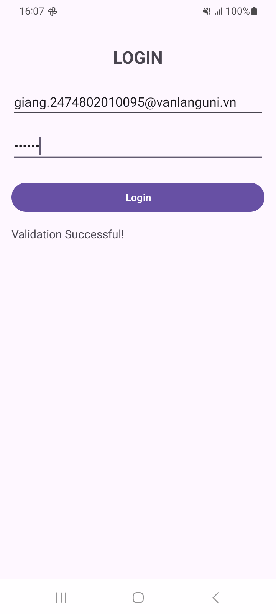

# THỰC HÀNH KIỂM TRA - LẬP TRÌNH ỨNG DỤNG DI ĐỘNG

Bài thực hành kiểm tra môn **Lập trình ứng dụng di động**, Khoa Công nghệ Thông tin, Trường Đại học Văn Lang.

- Họ tên: Kiều Bảo Giang
- MSSV: 2474802010095
- Nhánh hiện tại: `cau-1`

## Công nghệ sử dụng

- Android Studio, template **Empty Views Activity**, ngôn ngữ **Kotlin**
- Giao diện XML với **ConstraintLayout phẳng** (không lồng layout)
- Ánh xạ view bằng **findViewById**, không dùng ViewBinding
- minSdk 24, targetSdk 37

## Cấu trúc nhánh

| Nhánh | Nội dung |
|---|---|
| `main` | Project khởi tạo ban đầu |
| `cau-1` | Câu 1: màn hình Login và kiểm tra dữ liệu |

## Cách chạy

```bash
git clone https://github.com/Zang-1/KiemTra_LapTrinhUngDungDiDong_2474802010095.git
cd KiemTra_LapTrinhUngDungDiDong_2474802010095
git checkout cau-1
```

Mở thư mục bằng Android Studio, chờ Gradle sync xong rồi bấm **Run** trên máy ảo hoặc máy thật.

## Câu 1: Giao diện Login và kiểm tra dữ liệu

- `LoginActivity` (`activity_login.xml`) gồm tiêu đề, ô Email, ô Password, nút **Login** và TextView hiển thị trạng thái.
- Khi bấm **Login**, dữ liệu được kiểm tra theo thứ tự sau:

| Trường hợp | Thông báo trên TextView |
|---|---|
| Email và Password đều trống | Please enter your email and password. |
| Email trống | Email cannot be empty. |
| Password trống | Password cannot be empty. |
| Email sai định dạng (`Patterns.EMAIL_ADDRESS`) | Invalid email format. |
| Password dưới 6 ký tự | Password must be at least 6 characters. |
| Dữ liệu hợp lệ | Validation Successful! |

## Minh chứng Câu 1

| Dữ liệu không hợp lệ | Dữ liệu hợp lệ |
|---|---|
|  |  |
